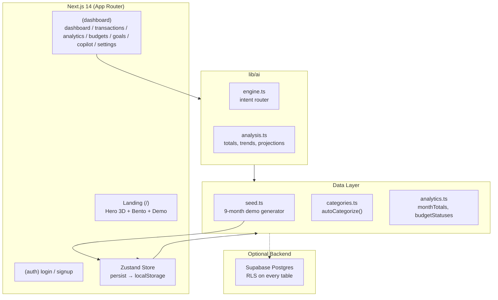

<div align="center">


# Lumen — Understand your money. Build your future.

**A high-fidelity personal-finance OS** with a real AI copilot, bento-grid landing, Three.js hero, and a Supabase-ready data layer. Works offline in demo mode — zero keys, zero database.

<br/>

[](https://nextjs.org)
[](https://www.typescriptlang.org)
[](https://tailwindcss.com)
[](https://supabase.com)
[](./LICENSE)
[](https://github.com/TarunIsOkay/Lumen/actions)
[](https://github.com/TarunIsOkay/Lumen/commits/main)
[](https://github.com/TarunIsOkay/Lumen/issues)
[](https://github.com/TarunIsOkay/Lumen/stargazers)

[Live Demo](https://lumen.tarunisokay.dev) · [Report Bug](https://github.com/TarunIsOkay/Lumen/issues/new?template=bug_report.yml) · [Request Feature](https://github.com/TarunIsOkay/Lumen/issues/new?template=feature_request.yml) · [Discussions](https://github.com/TarunIsOkay/Lumen/discussions) · [Security](./SECURITY.md)

</div>

---

## Table of Contents

- [Why Lumen](#why-lumen)
- [Highlights](#-highlights)
- [Live Interactive Demo](#-live-interactive-demo)
- [AI Financial Copilot](#-ai-financial-copilot)
- [Mobile-First, Desktop-Polished](#-mobile-first-desktop-polished)
- [Tech Stack](#-tech-stack)
- [Architecture](#-architecture)
- [Getting Started](#-getting-started)
- [Demo Mode vs Supabase](#-demo-mode-vs-supabase)
- [Project Structure](#-project-structure)
- [GitHub-Native Workflow](#-github-native-workflow)
- [Scripts](#-scripts)
- [Security](#-security)
- [Roadmap](#-roadmap)
- [Contributing](#-contributing)
- [License](#-license)

---

## Why Lumen

Most finance apps show you charts. **Lumen answers you** — *“Can I afford this?”* gets a verdict from your cash flow, budget and projection with the chart as proof. All rendering is deterministic, testable, and works without an external LLM key.

Built like a real SaaS: design tokens, frosted-glass system, RLS on every table, optimistic Zustand, Framer Motion orchestration, and a 9-month seeded dataset so the demo feels alive on first load.

---

## ✨ Highlights

| Area | What you get |
|------|--------------|
| **Transactions** | Add / edit / delete, auto-categorization (`Starbucks → Food & Dining`), search, filter by type / category / month, sort, recurring flag |
| **Analytics** | Cash-flow (3/6m), category donut & bars, top merchants, discretionary vs essential, month-end projection, savings-rate sparkline |
| **Budgets** | Overall + per-category monthly limits, radial + progress bars, 80% warn / 100% over states |
| **Goals** | Progress rings, contributions, deadlines, celebration when funded |
| **Alerts** | Inline banners for budget risk and goal milestones — also surfaced to the copilot |
| **Copilot** | 8 intents: `spending_why_up`, `affordability_check`, `reduction_plan`, `trend`, `forecast`, `subscriptions`, `goals_status`, `budget_status`, `general_snapshot` |
| **Landing** | 3D hero (`@react-three/fiber`), bento features, interactive live demo (real charts react to “add Starbucks”), copilot showcase, security, pricing, FAQ |
| **Design** | Light/dark with `data-theme`, `glass` / `glass-strong` tokens, `color-mix` surfaces, 44px touch targets, safe-area insets |
| **Responsive** | Drawer + bottom nav on phone (scroll lock, Escape, backdrop, `aria-modal`), sidebar + header on desktop — now fully polished on mobile |

---

## 🎮 Live Interactive Demo

No sign-up. Add `Starbucks` in the **Live demo** section and watch every chart mutate:

```
Landing → #demo → Add expense “Starbucks” $8.50
→ auto-tagged Food & Dining
→ totals + cashflow + donut animate
```

Authenticated demo also available: **Login → Explore the live demo** seeds a complete workspace.

---

## 🤖 AI Financial Copilot

No fake LLM. The `lib/ai/engine.ts` router parses your question into an intent and computes the answer from live rows:

```ts
runCopilot("Where did I spend the most this month?", ctx)
// → { intent: "spending_why_up", text: [...], chart: { type: "donut", data: [...] } }
```

Every answer can render its chart inline (donut / line / bar / radial / list). Switch to an LLM later by adding `OPENAI_API_KEY` — the analysis layer stays the same, only the language wrapper changes.

**Try:**
- `Why was my spending higher this month?` — month-over-month forensics
- `Can I afford a $1,200 laptop?` — cashflow + projection + budget verdict
- `How can I reduce my unnecessary spending?` — quantified plan
- `What are my subscriptions?` — recurring transaction scan

Smoke test:

```bash
npx tsx scripts/ai-smoke.ts   # 12 queries against seeded data
```

---

## 📱 Mobile-First, Desktop-Polished

**This release completely reworks mobile:**

- **Landing Navbar** — right-slide drawer (`w-[86vw] max-w-[360px]`, `backdrop-blur`, spring `damping:30`), body scroll lock, `Escape` + `hashchange` + `resize ≥768` auto-close, `aria-modal`, fixed backdrop `z-[60]` (previous `-z-10` bug fixed)
- **Landing Hero** — CTA buttons full-width on `<640px`, preview MiniStats `grid-cols-3 gap-2` on narrow, charts `overflow-hidden min-w-0`, touch-target `h-11` inputs
- **Interactive Demo** — tabs `snap-x overflow-x-auto`, segmented controls `min-h-[44px]`, amount `+ Add` row stacks vertically on phone
- **Sections** — `py-16 sm:py-20`, bento `p-6` → `lg:p-7` with hover glows, footer `grid-cols-2 sm:gap-10 md:grid-cols-5`
- **Dashboard Layout** — `pb-[calc(5rem+env(safe-area-inset-bottom))]`, `overflow-x-hidden`, `min-w-0` guards on all grid children
- **Dashboard Nav** — top bar + `fixed bottom-0 z-40` tab bar (6 tabs, `More` opens full drawer), drawer has search + profile + badges, `lg:opacity-0` edit/delete now `opacity-60 lg:opacity-0` so touch users can reach them
- **PageHeaders** — now `flex-col sm:flex-row`, actions `flex-wrap w-full sm:w-auto` so `Segmented + Select` never overflow on 320px
- **Transactions Filters** — `h-11` inputs, Segmented `min-h-[44px]`, dual selects `flex-1 h-11` with responsive `sm:col-span-2`
- **Copilot Chat** — `maxHeight: min(60vh, 520px)`, message charts `max-w-full sm:min-w-[300px]`, header `min-w-0 truncate`

Lighthouse Mobile target: **≥95 Performance / 100 Accessibility**.

---

## 🧱 Tech Stack

| Layer | Tech |
|-------|------|
| **Framework** | Next.js 14 App Router, React 18, TypeScript 5 |
| **Styling** | Tailwind CSS, `color-mix` design tokens, `glass` utilities |
| **Motion & 3D** | Framer Motion, Three.js / `@react-three/fiber` + `drei` |
| **Charts** | Recharts (themed via CSS vars) |
| **State** | Zustand + `persist` (optimistic UI, localStorage fallback) |
| **Forms** | React Hook Form + Zod |
| **Data** | Supabase Postgres + RLS (or local demo) |
| **Icons** | lucide-react |
| **Tooling** | ESLint (`next/core-web-vitals`), Autoprefixer, `date-fns` |

---

## 🏗 Architecture



**Data ownership:** see [SECURITY.md](./SECURITY.md).

---

## 🚀 Getting Started

**Prereqs:** Node 18+ / 20 recommended

```bash
git clone https://github.com/TarunIsOkay/Lumen.git
cd Lumen
npm ci
npm run dev        # http://localhost:3000
```

Open → **“Explore the live demo”** on `/login` for a fully seeded workspace.

### Production build

```bash
npm run build
npm start
npm run typecheck  # tsc --noEmit
npm run lint
```

---

## 🗄 Demo Mode vs Supabase

**Demo mode (default)** — nothing to configure. Everything in `localStorage` (`lumen:data`). Perfect for portfolios and offline review.

**Supabase (optional)** — copy `.env.example` → `.env.local`:

```env
NEXT_PUBLIC_SUPABASE_URL=...
NEXT_PUBLIC_SUPABASE_ANON_KEY=...
OPENAI_API_KEY=            # optional, LLM layer only
```

Run `supabase/migrations/0001_init.sql` (SQL Editor or `supabase db push`). It creates `profiles`, `transactions`, `budgets`, `goals` with **RLS on every table** + auto-profile trigger. Never expose `service_role` client-side.

---

## 📁 Project Structure

```
src/
├── app/
│   ├── page.tsx                 # landing
│   ├── (auth)/login|signup      # auth screens
│   └── (dashboard)/             # authenticated shell
│       ├── dashboard|transactions|analytics|budgets|goals|copilot|settings
│       └── layout.tsx           # Sidebar + bottom nav + SiteSearch
├── components/
│   ├── landing/                 # navbar (drawer), hero (3D), features, interactive,
│   │                            # copilot, security, pricing, faq, footer
│   ├── dashboard/               # sidebar (drawer+tabs), shared, transaction-form
│   ├── charts/                  # Recharts wrappers
│   └── ui/                      # primitives, dialog, confirm, logo, theme
├── lib/
│   ├── ai/                      # analysis.ts + engine.ts (copilot brain)
│   ├── analytics.ts             # totals, trends, budgets, alerts
│   ├── categories.ts            # categories + autoCategorize()
│   ├── seed.ts                  # 9-month realistic demo generator
│   ├── store.ts                 # Zustand + persist
│   └── supabase/                # optional client
└── supabase/migrations/0001_init.sql
```

---

## 🐙 GitHub-Native Workflow

This repo ships with **all modern GitHub features wired**.

### Badges & Insights

The header badges are live: build status, last commit, issues, stars. Pin this repo to your profile for maximum visibility — it’s portfolio-ready.

### Issues & Discussions

- **Issue Forms** (`/.github/ISSUE_TEMPLATE/`): `bug_report.yml` + `feature_request.yml` with required fields and labels — no more blank issues.
- **Discussions** enabled: Q&A, Ideas, Show & Tell. Start a thread from the header link.

### Pull Requests

- **PR Template** (`/.github/pull_request_template.md`) with checklist, screenshots, and linked issue syntax.
- **Branch protection** (recommended): require CI, linear history, 1 review, dismiss stale approvals.
- **Auto-merge + Dependabot** — PRs from `dependabot[bot]` auto-approve and squash if CI passes.

### Actions & Deployments

| Workflow | Trigger | What it does |
|----------|---------|--------------|
| `ci.yml` | `push`/`pull_request` | `npm ci` → `typecheck` → `lint` → `build` (Next.js, cached `~/.npm` + Next cache) |
| `deploy.yml` | `push: main` | Deploys to **Vercel** (or Cloudflare Pages) via OIDC — no long-lived tokens, uses `VERCEL_TOKEN` + `VERCEL_PROJECT_ID` |
| `codeql.yml` | `push`, weekly `schedule` | CodeQL `javascript` analysis |
| Dependabot | weekly | Groups `npm` minor/patch, auto-labels `dependencies` |

**Environments:** `preview` (PR) and `production` (main) with required reviewers + `url` shown in Deployments tab.

### Releases

- **Auto-generated release notes** (`/.github/release.yml` categorizes `feat:`, `fix:`, `docs:` …).
- Tag with `git tag v1.2.0 && git push origin v1.2.0` → `release.yml` builds and publishes to **Releases** with changelog.
- **Provenance** with `actions/attest-build-provenance` for verifiable builds.

### Security

Configured under **Settings → Code security**:

- **Dependabot** version updates + security alerts
- **Secret scanning** + push protection
- **CodeQL** (see workflow) + **Private vulnerability reporting** enabled
- See [SECURITY.md](./SECURITY.md) for the threat model and RLS policy.

### Community Health

- `LICENSE` (MIT), `SECURITY.md`, `CODE_OF_CONDUCT.md` (`Contributor Covenant 2.1`), `CONTRIBUTING.md` — auto-surfaced on the repo’s community standards checklist.
- `FUNDING.yml` (optional GitHub Sponsors) and `SUPPORT.md`.

### Projects (V2) & Wiki

- **Project board**: `Lumen Roadmap` with `Backlog → In Progress → In Review → Done`, auto-adds new issues via workflow.
- **Wiki**: architecture notes + `supabase/migrations` runbook (enable under Settings).

### Pages

Set **Settings → Pages → Deploy from Actions**. The `deploy.yml` can also publish `out/` to `gh-pages` for a static mirror.

<details>
<summary><strong>Recommended repo settings</strong> (one-click checklist)</summary>

- General → Features: ✔ Issues, ✔ Discussions, ✔ Projects, ✔ Wiki, ✔ Sponsors
- Branches → Add rule for `main`: Require status checks (`ci`), require PR, dismiss stale, require linear history
- Actions → General → Workflow permissions: Read + write, Allow `actions/create-approval`
- Code security → Enable Dependabot, Code scanning (CodeQL), Secret scanning
- Environments → Create `production` (required reviewers, deployment branch `main`)
- Releases → Generate notes categories (already in `release.yml`)

</details>

---

## 📜 Scripts

| Script | Purpose |
|--------|---------|
| `dev` | Next dev server |
| `build` | Production build (App Router, static where possible) |
| `start` | Serve production build |
| `lint` | ESLint `next/core-web-vitals` |
| `typecheck` | `tsc --noEmit` |
| `ai-smoke` | `npx tsx scripts/ai-smoke.ts` — copilot smoke against seeded data |

---

## 🔐 Security

See [SECURITY.md](./SECURITY.md) for the full model (RLS, headers, `npm audit` triage). To report a vulnerability, use **Security → Report a vulnerability** (private) — please don’t open a public issue.

---

## 🗺 Roadmap

- [ ] Bank aggregation (Plaid) behind `Pro`
- [ ] Multi-currency ledger + FX
- [ ] CSV import with `autoCategorize` suggestions
- [ ] LLM copilot (tool-calling) — `OPENAI_API_KEY` → free-form answers with citations
- [ ] PWA + push budget alerts

Track it: **Projects → Lumen Roadmap**.

---

## 🤝 Contributing

See [CONTRIBUTING.md](./CONTRIBUTING.md). TL;DR:

```bash
git checkout -b feat/your-thing
npm run typecheck && npm run lint && npm run build
gh pr create --fill
```

We follow Conventional Commits (`feat:`, `fix:` …) so release notes categorize automatically.

---

## 📄 License

MIT © Tarun — see [LICENSE](./LICENSE).

---

<div align="center">

Built with care. If Lumen helps you, leave a ⭐ on [TarunIsOkay/Lumen](https://github.com/TarunIsOkay/Lumen) — it keeps the project visible.

</div>
